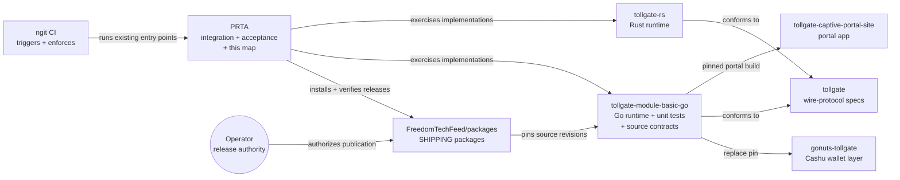

# The TollGate consolidation map

Status: **living document — update it in the same PR as the work it
describes.** This is the map of what we are doing: where the engineering
consolidation stands, what tracks next, and which tracker each piece
lives in. PRTA is its home because PRTA is the repo we merge to freely.

Division of labor, so nothing competes:

- **Rules** (ownership, verification hierarchy, agent principles):
  [engineering-policy.md](engineering-policy.md) — changes need
  cross-repo review.
- **Decision records** (runner consolidation M1–M4, behavior contracts):
  [authoritative-test-suite.md](authoritative-test-suite.md).
- **This document**: the live map — status, queue, sequencing. No rules
  live here.

## The shape we are consolidating toward

One sentence: implementations implement, the feed ships, PRTA verifies,
CI enforces, an operator releases — and nobody duplicates a neighbor.

The verification ladder (source → virtual integration → physical →
release acceptance, with the exact entry-point commands) is defined in
the [policy, §2](engineering-policy.md#2-verification-hierarchy); this
map never restates the commands.

## Workstream board

Updated 2026-10-13. Statuses are facts about trackers, not aspirations.

| # | Workstream | Tracker | Venue | Status |
|---|---|---|---|---|
| 1 | Runner consolidation M1 — blocking verdicts, shared deploy, fleet migration audit | PRTA [#216](https://github.com/OpenTollGate/physical-router-test-automation/pull/216) | PRTA | **merged** |
| 2 | Install moves router off LAN — fail fast | PRTA [#217](https://github.com/OpenTollGate/physical-router-test-automation/pull/217) | PRTA | **merged** |
| 3 | Cross-repository engineering policy + AGENTS ownership | PRTA [#218](https://github.com/OpenTollGate/physical-router-test-automation/pull/218) | PRTA | **merged** |
| 4 | Testing-docs centralization (root plans archived, guides into docs/) | PRTA [#219](https://github.com/OpenTollGate/physical-router-test-automation/pull/219) | PRTA | **merged** |
| 5 | Installer-contract gate (pristine apk VM, fail-closed, live evidence) | module [#892](https://github.com/OpenTollGate/tollgate-module-basic-go/pull/892) | module | **open — review**; carries the #913-contract question (preinst semantics changed on main; assertions kept red pending the decision) |
| 6 | SDK build staging preflight (portal products, staging verify, private PORTAL_DIR) | module [#918](https://github.com/OpenTollGate/tollgate-module-basic-go/pull/918) | module | **open — sign-off** |
| 7 | Hardware-fleet retirement marker (module tests/) | module [#916](https://github.com/OpenTollGate/tollgate-module-basic-go/pull/916) | module | **open — sign-off**; deletion itself is gated (see M4) |
| 8 | Module AGENTS ownership section + README pointer | module [#922](https://github.com/OpenTollGate/tollgate-module-basic-go/pull/922) | module | **open — sign-off** |
| 9 | AGENTS.md creates: feed / portal / wallet | feed [#83](https://github.com/FreedomTechFeed/packages/pull/83), portal [#73](https://github.com/OpenTollGate/tollgate-captive-portal-site/pull/73), gonuts [#43](https://github.com/OpenTollGate/gonuts-tollgate/pull/43) | neighbors | **open — review** |
| 10 | AGENTS.md creates: rust impl / protocol | rs [#28](https://github.com/OpenTollGate/tollgate-rs/pull/28), proto [#21](https://github.com/OpenTollGate/tollgate/pull/21) | neighbors | **parked** (operator: out of the current round) |
| 11 | Deployed-artifact contract tests (entry_ui ports, version ordering…) | PRTA [#196](https://github.com/OpenTollGate/physical-router-test-automation/pull/196) | PRTA | **open proposal** |
| 12 | Train-topology stop-ship scenarios + image-doctor preflight | PRTA [#201](https://github.com/OpenTollGate/physical-router-test-automation/pull/201) | PRTA | **open proposal** |
| 13 | Module shipping-package decommission (feed becomes sole shipping path) | module [#914](https://github.com/OpenTollGate/tollgate-module-basic-go/pull/914) direction | module + feed | **proposed** — needs operator decision + feed parity proof |
| 14 | Behavioral gate before announce (happy-path on the built x86_64 .apk, ngit-native artifact fetch) | module [#924](https://github.com/OpenTollGate/tollgate-module-basic-go/pull/924) | module | **open — sign-off**; step-level validation done, first live release run owed |
| 15 | apk-era upgrade + reboot scenario (state preservation, #899 listener invariant on upgrade) | PRTA [#225](https://github.com/OpenTollGate/physical-router-test-automation/pull/225) | PRTA | **merged**; first bench execution owed |
| 16 | Installer-contract lane wired per-rc into release-check + runbook | module [#925](https://github.com/OpenTollGate/tollgate-module-basic-go/pull/925) | module | **open — sign-off** |
| 17 | Fail-closed outcomes for required tests (skip ≠ PASS, venue rule) | PRTA [#227](https://github.com/OpenTollGate/physical-router-test-automation/pull/227) | PRTA | **merged**; required-set curation is incremental |

## Milestones ahead (smallest effective first)

1. **Enforce behavior at publication** — implemented as module
   [#924](https://github.com/OpenTollGate/tollgate-module-basic-go/pull/924)
   (open, pending sign-off): the fail-closed happy-path gate inside the
   ngit announce workflow, fetching the built x86_64 `.apk` from its
   shard build record. First live release run is the remaining evidence;
   until it merges and runs, nothing behavioral blocks an announcement.
2. **M3: stories tree consolidated** — landed as
   `tests/scenarios/stories/` (subtree move, conftest scoping preserved,
   29/29 collection equivalence, `test_story_evidence` 9/9 green; the
   path-based `hardware` rule now covers the stories — named skips in the
   virtual lab instead of fixture failures, inclusion in bench
   `-m hardware` sweeps). **Remaining from M3**: reduce `release-test.sh`
   to a thin profile over `run-profile.sh` / `test-pr.sh`.
3. **M2 remainder — landed**: the apk-era upgrade + reboot scenario is
   PRTA [#225](https://github.com/OpenTollGate/physical-router-test-automation/pull/225)
   (merged; first bench execution owed — flash/drain guards refuse
   fail-closed until then), and the per-rc wiring is module
   [#925](https://github.com/OpenTollGate/tollgate-module-basic-go/pull/925)
   (open, sign-off).
4. **NOT_VERIFIED everywhere — mechanism landed** (PRTA
   [#227](https://github.com/OpenTollGate/physical-router-test-automation/pull/227)):
   a `required`-marked test that skips fails as "NOT VERIFIED" (venue
   rule keeps hardware tests skippable in the virtual lab by design).
   Growing the required set is deliberate curation — seeded with the
   health baseline, tracked here.
5. **M4: delete legacy only through its gates** — fleet files go when
   their mapping rows have green hardware runs; `mint-health/` +
   `upstream-wifi/` Makefiles go when the pymake migration covers them.

## Reading the map later

- A workstream's status changes in the PR that lands it — edit the board
  in the same change.
- Anything not on this board and not in the policy is not a commitment.
- Parked means the operator deferred it; it is not abandoned and not
  approved.
